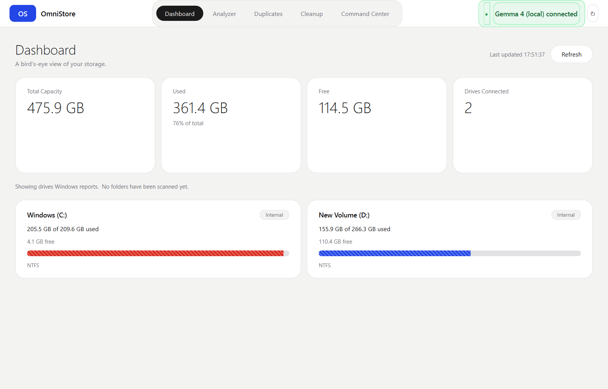
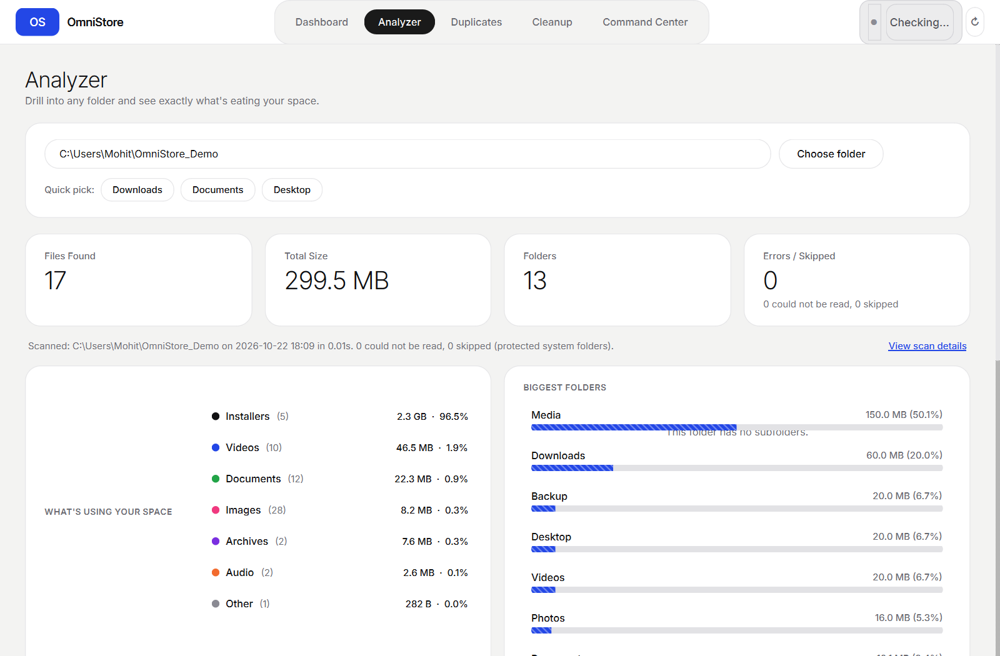
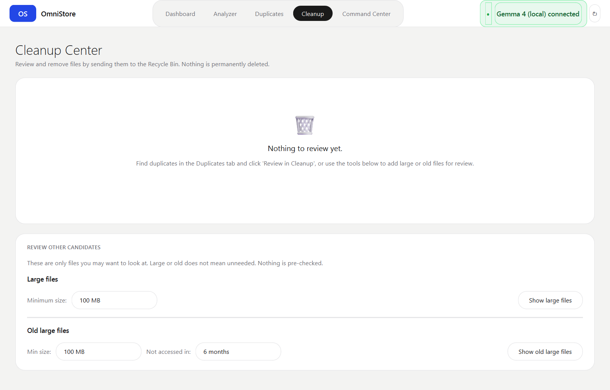
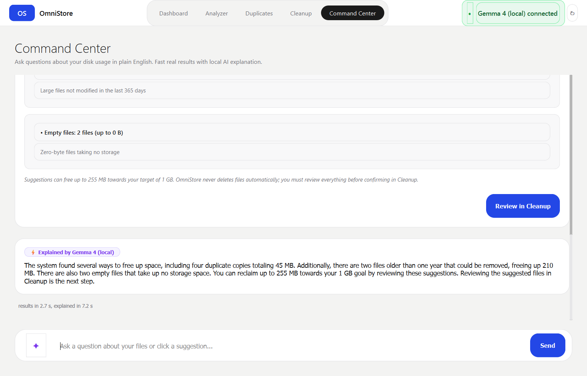

# OmniStore

> **One place to understand, find, and manage all your storage.**  
> A high-performance Windows desktop storage intelligence application built with Python 3.11+ and PySide6.  
> **Author:** Mohit Fegade  
> **Full Documentation:** [docs/submission.md](docs/submission.md)

---

## Highlights & Safety Guarantees

- **Zero Permanent Deletion**: Files are never permanently deleted using `os.remove` or `shutil.rmtree`. All deletions route safely to the Windows Recycle Bin via `send2trash` with explicit confirmation dialogs.
- **Pure-Python Architecture Isolation**: `engine/`, `commands/`, and `gemma/` contain zero PySide6 / Qt dependencies. The business logic is 100% testable headless.
- **Local & Private AI**: Powered by local Google Gemma 4 models running via Ollama (`127.0.0.1:11434`). Zero cloud transmissions; file contents are never read; all metadata exchanges are logged to `ai_audit_log.jsonl`.
- **Fast Staged Flow**: Command Center renders visual results from deterministic engine tools in 1–2 seconds, followed by streaming natural-language explanations from Gemma.
- **Deterministic Offline Fallback**: If Ollama or Gemma is offline, OmniStore automatically runs in fast Basic mode with a rule-based parser and zero downtime.
- **64-bit Integer Safety**: Employs `Signal(object)` for byte counts, fully eliminating 32-bit integer overflow issues on multi-terabyte scans.

---

## Core Modules

1. **Dashboard (`ui/dashboard.py`)**: Real-time disk capacity meters, health indicators, and quick action launchers.
2. **Storage Analyzer (`ui/analyzer.py`)**: Deep directory scanner with category distribution breakdown and interactive folder treemap.
3. **Duplicates Manager (`ui/duplicates.py`)**: Fast 3-tier duplicate detection (size -> 4 KB header/footer sample -> SHA256) with auto-selection rules.
4. **Safe Cleanup Center (`ui/cleanup.py`)**: Categorized queues for temporary files, caches, old downloads, empty files, and duplicate copies, moving them to the Recycle Bin.
5. **Command Center (`ui/command_center.py`)**: Conversational English search with 6 suggestion chips, progressive rendering, and local Gemma intelligence.

---

## Screenshots

| Dashboard | Storage Analyzer |
|---|---|
|  |  |

| Duplicates & Cleanup | Command Center (Gemma 4) |
|---|---|
|  |  |

---

## Requirements

- **OS**: Windows 10 / Windows 11 (64-bit)
- **Python**: 3.11 or newer
- **Local AI (Optional)**: [Ollama](https://ollama.com) with `gemma4:e2b` or any Gemma model

---

## Setup & Run

```powershell
# 1. Clone repository
git clone https://github.com/Mohitfegade/OmniStore.git
cd OmniStore

# 2. Create and activate virtual environment
python -m venv .venv
.venv\Scripts\activate

# 3. Install pinned dependencies
pip install -r requirements.txt

# 4. Generate demo dataset (optional sandbox)
python tests/make_demo_data.py

# 5. Launch OmniStore
python main.py
```

### Local Gemma AI Setup:
```powershell
# In a separate terminal:
ollama pull gemma4:e2b
ollama serve
```
When running, the top-bar badge automatically turns green: **`● Gemma 4 (local) connected`**.

---

## Verification & Test Suite

OmniStore includes 15 automated test suites:

```powershell
# Run the complete test suite:
& "d:\OmniStore\.venv\Scripts\python.exe" -c "
import os, subprocess, sys
for f in sorted([f for f in os.listdir('tests') if f.endswith('.py') and f.startswith(('check_', 'test_'))]):
    res = subprocess.run([sys.executable, os.path.join('tests', f)], capture_output=True, text=True)
    status = 'PASS' if res.returncode == 0 else f'FAIL ({res.returncode})'
    print(f'{f:30} {status}')
"
```

Individual test checks:
- `python tests/check_basic_parser.py`: Validates 18 NLP query patterns with the offline rule-based parser.
- `python tests/check_tools.py`: Validates all 7 read-only tool contracts and argument schemas.
- `python tests/check_signals.py`: Validates AST signal safety and 64-bit integer emissions.
- `python tests/check_gemma.py`: Validates local Gemma connection, fact-checking assertions, and audit log.
- `python tests/check_command_flow.py`: Validates end-to-end staged flow and latency benchmarks.
- `python tests/check_ui_chips.py`: Validates live UI execution of all 6 Command Center suggestion chips.
- `python tests/test_cleanup_ui.py`: Validates Cleanup UI widgets and confirmation modals.
- `python tests/test_duplicates_ui.py`: Validates duplicate grouping and selection filters.
- `python tests/test_e2e_cleanup_flow.py`: Validates end-to-end scan-to-recycle-bin safety flow.
- `python tests/test_large_scan_ui.py`: Validates UI stability under large-scale file scans.

---

## Documentation

- [docs/submission.md](docs/submission.md) — Comprehensive submission report & architecture overview
- [docs/demo_script.md](docs/demo_script.md) — 90-second judge walkthrough & presentation script
- [docs/status.md](docs/status.md) — Pre-submission readiness audit and checklist
- [docs/contract_command_center.md](docs/contract_command_center.md) — Command Center staged flow specification
- [docs/contract_gemma.md](docs/contract_gemma.md) — Gemma provider interface & privacy constraints
- [docs/signal_fix.md](docs/signal_fix.md) — 64-bit signal overflow architectural analysis
