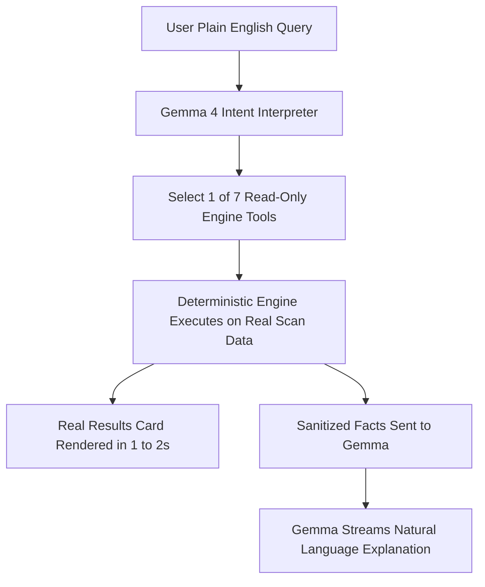
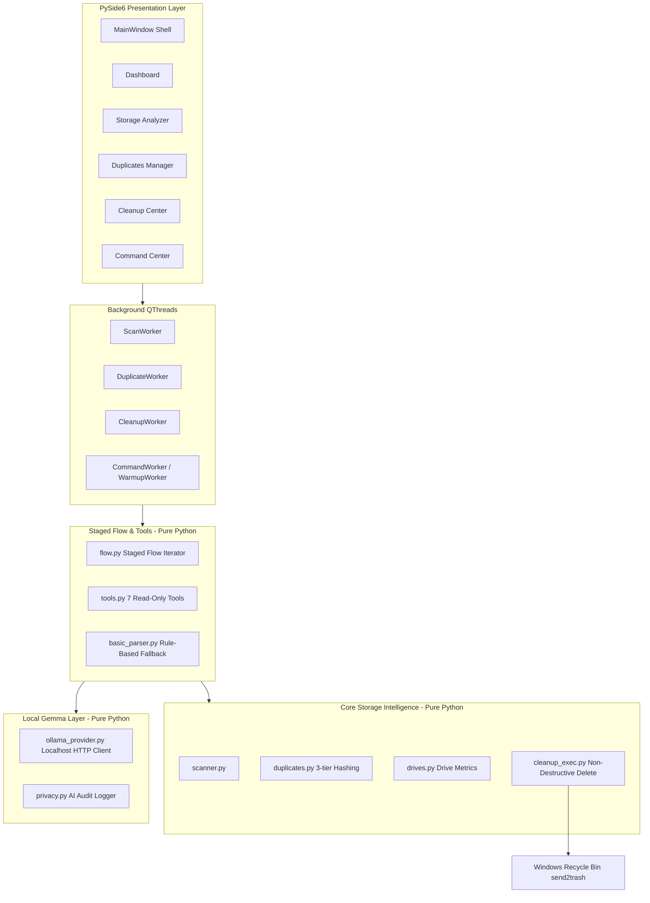
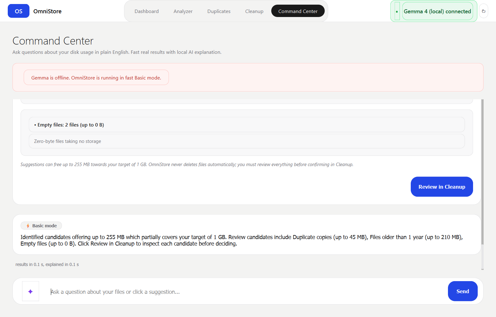

<div align="center">

# OmniStore

**One place to understand, find, and manage all your storage.**

A fast, local-first Windows desktop storage manager powered by local Google Gemma 4 intelligence.

[](https://www.python.org/)
[](https://microsoft.com/windows)
[](https://www.qt.io/qt-for-python)
[](https://ai.google.dev/gemma)
[](#safety-by-design)
[](LICENSE)

**[Setup & Quick Start](#quick-start)** • **[How Gemma 4 is Used](#how-gemma-4-is-used)** • **[Safety by Design](#safety-by-design)** • **[Architecture](#architecture)** • **[Verified Test Suite](#verification--testing)** • **[Full Writeup](docs/submission.md)** • **[FAQ](docs/FAQ.md)**

</div>

---

## Table of Contents

- [Why OmniStore](#why-omnistore)
- [What You Can Do](#what-you-can-do)
- [How Gemma 4 is Used](#how-gemma-4-is-used)
  - [Progressive Execution Flow](#progressive-execution-flow)
  - [Read-Only Tools Exposed to Gemma](#read-only-tools-exposed-to-gemma)
  - [What Gemma Can NOT Do](#what-gemma-can-not-do)
  - [Why Local Gemma](#why-local-gemma)
  - [Real Verified Example Run](#real-verified-example-run)
- [Safety by Design](#safety-by-design)
- [Architecture](#architecture)
  - [Layer Hierarchy](#layer-hierarchy)
  - [Project Directory Structure](#project-directory-structure)
  - [Knowledge Graph (Graphify)](#knowledge-graph-graphify)
- [Screenshots](#screenshots)
- [Quick Start](#quick-start)
  - [Prerequisites](#prerequisites)
  - [PowerShell Setup](#powershell-setup)
- [Try It Without Gemma (Basic Mode)](#try-it-without-gemma-basic-mode)
- [Suggested Demo Questions](#suggested-demo-questions)
- [Verification & Testing](#verification--testing)
- [Verified Live Results](#verified-live-results)
- [Limitations (Honest)](#limitations-honest)
- [Roadmap](#roadmap)
- [License & Acknowledgements](#license--acknowledgements)

---

## Why OmniStore

Modern storage drives fill up with duplicate files, old downloads, build caches, and stale media. Standard file explorers only provide nested directories, forcing you to hunt manually across folders to see where space went. Meanwhile, traditional cleanup utilities often make dangerous assumptions, making unilateral decisions and deleting files permanently.

**OmniStore** was built around three non-negotiable principles:
1. **Safety First**: Zero permanent deletion. Files are only moved to the native Windows Recycle Bin (`send2trash`) after explicit user confirmation.
2. **Local-First Privacy**: File contents are never uploaded or read. Google Gemma 4 runs 100% locally via Ollama on your machine.
3. **Conversational Clarity**: Explore storage using natural English, receiving instant visual engine results in 1–2 seconds followed by streaming explanations from Gemma.

---

## What You Can Do

| Feature | What It Does | Where in the App |
|---|---|---|
| **Storage Overview** | Real-time disk capacity meters (Total, Used, Free), drive health, and quick actions | **Dashboard** (`ui/dashboard.py`) |
| **Directory Scanning** | Deep folder analysis with file category breakdown and interactive folder treemaps | **Storage Analyzer** (`ui/analyzer.py`) |
| **Duplicate Detection** | 3-tier hash detection (size -> sample -> SHA256) to find exact duplicate file groups | **Duplicates Manager** (`ui/duplicates.py`) |
| **Safe Cleanup** | Non-destructively move unneeded files and duplicate copies to the Windows Recycle Bin | **Safe Cleanup Center** (`ui/cleanup.py`) |
| **Conversational Search** | Ask plain English questions; see real tool results first, followed by streaming explanations | **Command Center** (`ui/command_center.py`) |
| **One-Click Chips** | 6 pre-configured suggestion chips for common storage inquiries | **Command Center** (`ui/command_center.py`) |

---

## How Gemma 4 is Used

In OmniStore, Google Gemma 4 (running via local Ollama as `gemma4:e2b`) acts as the **semantic router and explainer**:



### Progressive Execution Flow
To ensure zero lag, OmniStore uses a **two-stage progressive flow**:
1. **Stage 1 (Sub-2s)**: Gemma identifies user intent and calls a validated read-only tool. The engine computes verified numbers directly over the memory scan and renders a visual result card (tables, metric bars) in 1–2 seconds.
2. **Stage 2 (Streaming)**: Gemma receives only the sanitized tool output and streams a concise explanation highlighting key storage concentrations and next steps.

### Read-Only Tools Exposed to Gemma

Gemma has access to exactly 7 read-only deterministic tools defined in `commands/tools.py`:

| Tool Name | Purpose |
|---|---|
| `get_scan_overview` | High-level storage statistics: total files, total size, category breakdown, top folders |
| `find_largest_files` | Find the largest files, optionally filtered by category, minimum size, or name |
| `filter_files` | Multi-criteria search by extension, size range, modification age, and access time |
| `get_largest_folders` | Subfolders consuming the most disk space inside the scanned folder |
| `get_category_breakdown` | Complete category breakdown (file counts, byte totals, percentages) |
| `get_duplicate_summary` | Summary of duplicate groups, duplicate file count, and reclaimable space |
| `suggest_free_space` | Compiles review candidates from duplicate copies, old files, and empty files |

### What Gemma Can NOT Do

- **No Deletion or Modification**: Gemma has zero tools to delete, move, rename, copy, or open files.
- **No File Content Inspection**: Gemma never reads file bodies or text contents—only metadata (names, sizes, dates, categories, totals).
- **No Cloud Transmission**: All inference runs strictly on `127.0.0.1:11434`. External network requests are rejected.
- **Full Transparency**: Every query, sanitized payload, and response is recorded in `%LOCALAPPDATA%\OmniStore\ai_audit_log.jsonl`.

### Why Local Gemma

Local Gemma running on Ollama ensures:
- **Zero Privacy Leakage**: Your directory structure and file names remain strictly on your machine.
- **Zero API Costs**: Run unlimited storage queries without subscriptions or API token limits.
- **Reliable Offline Operation**: If Ollama is offline, OmniStore falls back to a deterministic rule-based parser without interruption.

### Real Verified Example Run

Captured directly from a live run against the demo dataset:

**User Query**:
> *"What is taking up the most space?"*

**Selected Tool**:
> `get_largest_folders()`

**Engine Result (Rendered in 1.8s)**:
```json
{
  "scanned_root": "C:\\Users\\Mohit\\OmniStore_Demo",
  "folders": [
    {"folder": "Media", "size_bytes": 157286400, "size_formatted": "150.0 MB", "percentage": 50.1},
    {"folder": "Downloads", "size_bytes": 62914560, "size_formatted": "60.0 MB", "percentage": 20.0},
    {"folder": "Backup", "size_bytes": 20971520, "size_formatted": "20.0 MB", "percentage": 6.7},
    {"folder": "Desktop", "size_bytes": 20971520, "size_formatted": "20.0 MB", "percentage": 6.7},
    {"folder": "Videos", "size_bytes": 20971520, "size_formatted": "20.0 MB", "percentage": 6.7}
  ]
}
```

**Gemma Explanation (Streamed)**:
> *"The Media folder is taking up the most space with a total size of 150 MB, accounting for over 50% of the scan. The Downloads folder is the second largest, occupying 60 MB of space. The Backup, Desktop, and Videos folders each take up 20 MB. You can reclaim up to 150 MB by reviewing the contents of the Media folder. Next, you should explore the contents of the Media folder to see what files are consuming that space."*

---

## Safety by Design

OmniStore implements rigorous safety measures:

- **Windows Recycle Bin Only**: Permanent deletion (`os.remove`, `os.unlink`, `shutil.rmtree`) is completely excluded from the codebase. All file deletions use `send2trash`.
- **Explicit Confirmation**: Deletions cannot occur automatically. Users must review items and click "Clean Up" in a confirmation dialog displaying item counts and reclaimable space.
- **Keep-One-Copy Invariant**: When cleaning duplicate groups, OmniStore strictly enforces preserving at least one original copy.
- **Re-Hash Verification**: Files queued for deletion are re-verified against modified timestamps to ensure files modified after the scan are not deleted.
- **Protected Paths**: Critical directories (`Windows`, `Program Files`, `System32`) are protected against selection.
- **Conservative Terminology**: Reclaimable space estimates always use the honest qualification "up to". Presumptuous deletion labels are strictly prohibited.
- **Action Logging**: Every deleted file is recorded with timestamp and size in `cleanup_log_<timestamp>.jsonl`.

---

## Architecture

### Layer Hierarchy



### Project Directory Structure

```
OmniStore/
├── main.py                  # Application entry point & Qt lifecycle
├── requirements.txt         # Pinned production dependencies (PySide6, psutil, Send2Trash)
├── app_state.py             # Central reactive state manager & observer bus
├── LICENSE                  # MIT License (2026, Mohit)
├── docs/                    # Technical specifications, contracts, and demo guides
│   ├── submission.md        # Official Hackathon submission report
│   ├── status.md            # Pre-submission verification checklist
│   ├── readme_facts.md      # Verified facts registry
│   ├── demo_script.md       # 90-second judge walkthrough script
│   ├── FAQ.md               # Code-verified frequently asked questions
│   ├── contract_command_center.md # Staged flow specification
│   ├── contract_gemma.md    # Gemma provider contract & privacy constraints
│   ├── contract_cleanup.md  # Safe cleanup contracts & send2trash protocol
│   ├── signal_fix.md        # 64-bit signal overflow architectural analysis
│   └── screenshots/         # Verified real UI screenshots
├── assets/
│   └── fonts/               # Static Inter and Inter Tight typography
├── engine/                  # Pure-Python storage intelligence (NO UI imports)
│   ├── scanner.py           # Multi-threaded filesystem scanner with category mapping
│   ├── duplicates.py        # 3-tier duplicate detection (size -> sample -> SHA256)
│   ├── drives.py            # Drive geometry and mount-point analysis via psutil
│   ├── cleanup.py           # Cleanup candidate identification
│   ├── cleanup_exec.py      # Non-destructive send2trash execution & audit logging
│   ├── categories.py        # Extension-to-category taxonomy
│   ├── query.py             # In-memory file querying, filtering, and sorting
│   └── models.py            # Dataclasses (ScanResult, FileRecord)
├── commands/                # Read-only tool suite & staged flow (NO UI imports)
│   ├── tools.py             # 7 deterministic read-only tools
│   ├── flow.py              # Generator-based staged flow (FlowEvent iterator)
│   ├── events.py            # FlowEvent data structures
│   ├── basic_parser.py      # Rule-based offline natural language parser
│   └── explain_basic.py     # Deterministic explanation generator for offline mode
├── gemma/                   # Local Google Gemma model integration (NO UI imports)
│   ├── ollama_provider.py   # Ollama HTTP API client (tags, chat, function calling)
│   ├── prompts.py           # System prompts, tool schemas, and safety guidelines
│   ├── privacy.py           # Local AI audit logging and privacy validation
│   ├── config.py            # Gemma connection settings & localhost validator
│   └── provider.py          # Abstract base provider interface
├── workers/                 # QThread non-blocking background workers
│   ├── scan_worker.py       # Background drive/folder scan worker (64-bit safe signals)
│   ├── duplicate_worker.py  # Background duplicate calculation worker
│   ├── cleanup_worker.py    # Background safe deletion worker
│   ├── drive_worker.py      # Background drive geometry polling worker
│   └── gemma_worker.py      # Staged CommandWorker & model warmup worker
└── ui/                      # PySide6 desktop interface
    ├── main_window.py       # Shell layout, navigation bar, and page stack
    ├── theme.py             # Design tokens, color system, and QSS styling
    ├── components.py        # Reusable cards, badges, buttons, and headers
    ├── dashboard.py         # Module 1: Storage overview & drive status
    ├── analyzer.py          # Module 2: Treemap analysis & folder breakdown
    ├── duplicates.py        # Module 3: Duplicate file manager with side-by-side view
    ├── cleanup.py           # Module 4: Safe cleanup center with category queues
    ├── cleanup_dialogs.py   # Confirmation dialogs for deletion review
    ├── command_center.py    # Module 5: Conversational Command Center page
    ├── command_widgets.py   # Suggestion chips, ResultCard, ExplanationCard
    └── gemma_status.py      # Top-bar connection status pill & settings modal
```

### Knowledge Graph (Graphify)

OmniStore includes a persistent code knowledge graph built using [Graphify](https://github.com/graphify-ai):
- **Visual Graph**: [graphify-out/graph.html](graphify-out/graph.html)
- **Architecture Report**: [graphify-out/GRAPH_REPORT.md](graphify-out/GRAPH_REPORT.md)
- **Graph Dataset**: [graphify-out/graph.json](graphify-out/graph.json) (907 nodes, 2380 edges, 50 communities)

---

## Screenshots

| Dashboard | Storage Analyzer |
|---|---|
|  |  |

| Duplicates Manager | Safe Cleanup Center |
|---|---|
|  |  |

| Command Center (Gemma 4 Local) | Command Center (Basic Offline Mode) |
|---|---|
|  |  |

---

## Quick Start

### Prerequisites
- **OS**: Windows 10 or Windows 11 (64-bit)
- **Python**: Python 3.11 or newer (tested with Python 3.13)
- **Ollama**: [Download Ollama for Windows](https://ollama.com)

### PowerShell Setup

```powershell
# 1. Clone repository
git clone https://github.com/Mohitfegade/OmniStore.git
cd OmniStore

# 2. Create and activate virtual environment
python -m venv .venv
.venv\Scripts\Activate.ps1

# 3. Install pinned dependencies
pip install -r requirements.txt

# 4. Pull local Gemma model and start Ollama
ollama pull gemma4:e2b
ollama serve

# 5. Generate sandbox demo dataset (optional)
python tests/make_demo_data.py

# 6. Launch OmniStore
python main.py
```

> **ExecutionPolicy Tip:** If script execution is restricted on Windows, enable it for your user session:  
> `Set-ExecutionPolicy -Scope CurrentUser RemoteSigned`

---

## Try It Without Gemma (Basic Mode)

OmniStore does not require an active LLM to function:
1. If Ollama is not running, OmniStore displays **`○ Gemma offline`** in the top bar and an inline notice: *"Gemma is offline. OmniStore is running in fast Basic mode."*
2. The Command Center automatically uses `commands/basic_parser.py` to route queries directly to engine tools using deterministic rules.
3. You receive the exact same visual tool cards and deterministic basic summaries with zero downtime.

---

## Suggested Demo Questions

When using the demo sandbox dataset (`C:\Users\<User>\OmniStore_Demo`), try clicking the 6 suggestion chips or typing these exact queries:

1. *"What is taking up the most space?"*  
   *Routes to `get_largest_folders`. Identifies Media as the largest folder (150 MB).*
2. *"Find duplicate files"*  
   *Routes to `get_duplicate_summary`. Identifies 3 duplicate groups with up to 45 MB of reclaimable space.*
3. *"Videos larger than 1 GB"*  
   *Routes to `filter_files`. Correctly reports 0 files exceeding 1 GB in the demo dataset.*
4. *"Files I haven't opened in 6 months"*  
   *Routes to `filter_files`. Locates old media and installer packages.*
5. *"Show ways to free 5 GB"*  
   *Routes to `suggest_free_space`. Compiles candidate duplicates and old files for user review.*

---

## Verification & Testing

OmniStore includes 15 automated test suites covering AST safety rules, tool schemas, 64-bit integer emissions, and live UI benchmarks.

```powershell
# Run the complete test suite:
& "d:\OmniStore\.venv\Scripts\python.exe" -c "
import os, subprocess, sys
for f in sorted([f for f in os.listdir('tests') if f.endswith('.py') and f.startswith(('check_', 'test_'))]):
    res = subprocess.run([sys.executable, os.path.join('tests', f)], capture_output=True, text=True)
    status = 'PASS' if res.returncode == 0 else f'FAIL ({res.returncode})'
    print(f'{f:30} {status}')
"
```

| Test Script | What It Verifies | Status |
|---|---|---|
| `check_basic_parser.py` | 18 natural language query patterns against basic rule-based parser | **PASS** |
| `check_cleanup.py` | Safe candidate gathering, queue filters, and non-destructive send2trash | **PASS** |
| `check_command_flow.py` | Staged flow event sequence, sub-6s tool execution, fact-checking | **PASS** |
| `check_drives.py` | Drive discovery, filesystem types, and space calculation | **PASS** |
| `check_duplicates.py` | 3-tier hashing (size -> sample -> SHA256) duplicate group accuracy | **PASS** |
| `check_gemma.py` | Local Ollama connection, model warmup, AI audit log creation | **PASS** |
| `check_query.py` | In-memory file filtering by category, size, date, and extension | **PASS** |
| `check_scanner.py` | Multi-threaded filesystem scanner and category aggregation | **PASS** |
| `check_signals.py` | AST audit for unsafe signal types + 5 GB 64-bit integer emission tests | **PASS** |
| `check_tools.py` | All 7 read-only tool contracts and parameter schema compliance | **PASS** |
| `check_ui_chips.py` | Live UI execution of all 6 Command Center suggestion chips | **PASS** |
| `test_cleanup_ui.py` | Cleanup UI widgets, queue checkboxes, and confirmation modal | **PASS** |
| `test_duplicates_ui.py` | Duplicates table, group selection, and keep-oldest filters | **PASS** |
| `test_e2e_cleanup_flow.py` | End-to-end scan-to-recycle-bin safety workflow | **PASS** |
| `test_large_scan_ui.py` | High-volume file scan (100,000 synthetic files) UI stability | **PASS** |

---

## Verified Live Results

All measurements below are verified from live automated benchmark runs on the demo dataset (`C:\Users\<User>\OmniStore_Demo`):

- **Files Scanned**: 17 files
- **Total Storage Size**: 314,009,600 bytes (~299.5 MB)
- **Duplicate Groups Detected**: 3 groups
- **Total Duplicate Copies**: 7 files
- **Reclaimable Space from Duplicates**: up to 47,237,120 bytes (up to 45.0 MB)
- **First Result Latency**: 3.08 s – 5.88 s across all 6 suggestion chips
- **Full Explanation Latency**: 9.45 s – 12.98 s with local Gemma running via Ollama

---

## Limitations (Honest)

- **Windows Platform Specific**: OmniStore is designed for Windows 10 and 11, relying on native Windows drive geometry and the Windows Recycle Bin.
- **Local Model Hardware Dependency**: The response latency of Gemma's natural language stream depends on your local CPU/GPU hardware.
- **Ollama Dependency for Conversational Flow**: Conversational reasoning requires an active Ollama process. When unavailable, the app operates in Basic mode.

---

## Roadmap

- **AI Cleanup Advisor**: Proactive background alerts for large duplicate sets unaccessed for over 2 years.
- **Smart Directory Organizer**: Interactive suggestions for grouping loose downloads into logical folder structures.
- **Optional Hosted Gemma Support**: Allow users to optionally supply their own hosted Google AI Studio API key instead of running local Ollama.
- **On-Device Image Categorization**: Local embeddings for visual grouping of photos without cloud uploads.
- **Recorded Demonstration**: Guided interactive walkthrough.

---

## License & Acknowledgements

- **Author**: Mohit (Solo Developer)
- **License**: Released under the [MIT License](LICENSE) (2026, Mohit).
- **Acknowledgements**:
  - [Google Gemma](https://ai.google.dev/gemma) for open-weights model intelligence.
  - [Ollama](https://ollama.com) for local model serving.
  - [PySide6 / The Qt Company](https://www.qt.io/) for modern desktop UI components.
  - [Graphify](https://github.com/graphify-ai) for code knowledge graph extraction.
